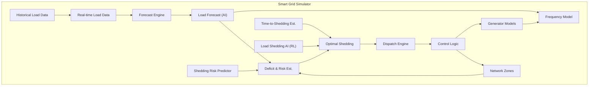
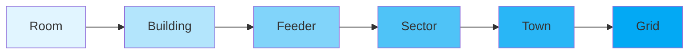
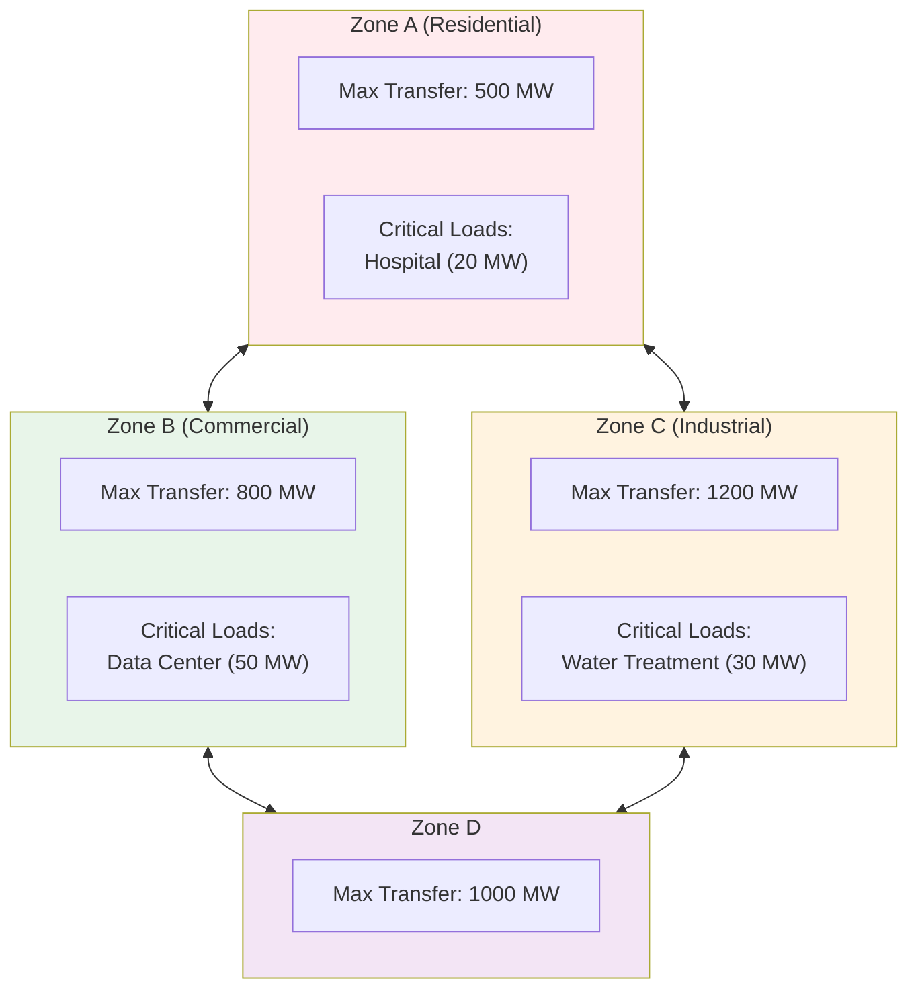
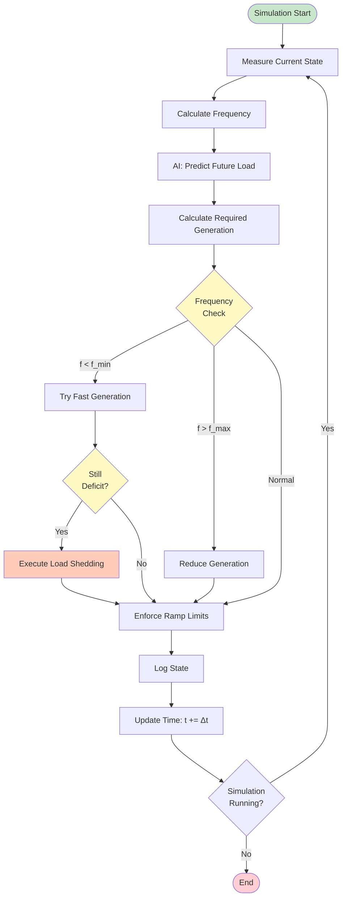
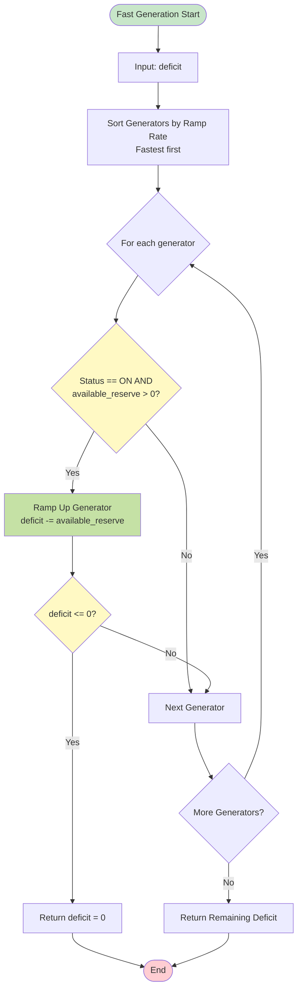
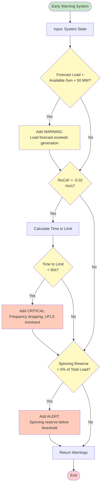

# Smart Grid AI-Powered Simulator - Technical Specification

## Table of Contents

1. [Core Objective](#core-objective)
2. [System Architecture](#system-architecture)
3. [Core Subsystems](#core-subsystems)
4. [Generation Model](#generation-model)
5. [Load Model](#load-model)
6. [Network & Zone Model](#network--zone-model)
7. [Frequency Model](#frequency-model)
8. [Operating Limits](#operating-limits)
9. [Load Shedding System](#load-shedding-system)
10. [Dispatch & Control Logic](#dispatch--control-logic)
11. [AI Integration](#ai-integration)
12. [Early Warning System](#early-warning-system)
13. [Data Logging & Metrics](#data-logging--metrics)
14. [Simulation Engine](#simulation-engine)
15. [Implementation Phases](#implementation-phases)

---

## Core Objective

The simulator must maintain grid stability by ensuring:

```
Σ Generation(t) − Σ Load(t) − Losses(t) ≈ 0
```

**If this fails → frequency deviates → grid collapses.**

The system must:
- Predict load imbalances before they occur
- Estimate time-to-load-shedding accurately
- Minimize total load shed while maintaining stability
- Prevent cascading blackouts
- Optimize generation dispatch economically

---

## System Architecture

### High-Level Architecture



### Design Principles

1. **AI Suggests, Physics Enforces, Protection Acts Last**
   - AI optimizes decisions but does not replace physics
   - All safety thresholds remain rule-based
   - Protection systems have final authority

2. **Modular & Scalable**
   - Start with single power station, single load bus
   - Scale to multi-zone, multi-generator systems
   - Support incremental complexity

3. **Realistic Constraints**
   - Generator ramp limits
   - Startup delays
   - Network transfer capacity
   - Frequency dynamics

---

## Core Subsystems

The system requires **6 core subsystems**:

1. **Generation Model** - Models power plants with realistic constraints
2. **Load Model** - Bottom-up load aggregation with time-dependent profiles
3. **Network/Zones** - Geographic and electrical zones with transfer limits
4. **Frequency Model** - Swing equation-based frequency dynamics
5. **Load Shedding Logic** - Priority-based, selective load disconnection
6. **Control & Dispatch Logic** - Real-time decision engine

---

## Generation Model

### Generator Parameters

Each generator must have the following parameters:

| Parameter | Type | Description | Example Values |
|-----------|------|-------------|----------------|
| `id` | string | Unique identifier | "GEN_001" |
| `type` | enum | Generator type | steam, gas, diesel, hydro, renewable |
| `P_max` | float (MW) | Maximum output capacity | 1400 MW |
| `P_min` | float (MW) | Minimum stable output | 300 MW |
| `ramp_rate` | float (MW/sec) | Maximum ramp rate | 10 MW/min |
| `inertia_constant` | float (sec) | Inertia constant H | 5-10 seconds |
| `fuel_cost` | float ($/MWh) | Operating cost | 50-100 $/MWh |
| `startup_time` | float (sec) | Time to start from cold | 30 min |
| `status` | enum | Current status | ON, OFF, STARTING, TRIPPED |
| `efficiency` | float (0-1) | Conversion efficiency | 0.35-0.55 |

### Generator State

| State Variable | Type | Description |
|----------------|------|-------------|
| `current_output` | float (MW) | Current power output |
| `available_reserve` | float (MW) | P_max - current_output |
| `ramp_direction` | enum | UP, DOWN, HOLD |
| `time_since_start` | float (sec) | For startup tracking |

### Generator Constraints

**Power Limits:**
```
P_min ≤ P(t) ≤ P_max
```

**Ramp Rate Limits:**
```
|dP/dt| ≤ ramp_rate
```

**Update Rule:**
```python
P(t+Δt) = clamp(
    P(t) ± ramp_rate * Δt,
    P_min,
    P_max
)
```

### Generator Types & Characteristics

| Type | Ramp Rate | Startup Time | Inertia | Typical Use |
|------|-----------|--------------|---------|-------------|
| Steam | 5-10 MW/min | 30-60 min | High (8-10s) | Base load |
| Gas | 20-50 MW/min | 5-15 min | Medium (4-6s) | Peak load |
| Diesel | 30-60 MW/min | 2-5 min | Low (2-4s) | Emergency |
| Hydro | 50-100 MW/min | 1-3 min | Medium (4-6s) | Flexible |
| Renewable | Variable | N/A | Low (1-2s) | Intermittent |

---

## Load Model

### Load Aggregation Hierarchy



### Load Parameters

| Parameter | Type | Description | Example |
|-----------|------|-------------|---------|
| `id` | string | Unique identifier | "LOAD_RES_001" |
| `type` | enum | Load category | residential, commercial, industrial |
| `priority` | int | Shedding priority (1=highest) | 1-5 |
| `P_nominal` | float (MW) | Nominal power demand | 50 MW |
| `load_profile(t)` | function | Time-dependent factor | 0.5-1.5 |
| `sheddable` | bool | Can be disconnected | true/false |
| `zone_id` | string | Geographic zone | "ZONE_A" |

### Load Profile (Time Dependent)

```
P_load(t) = P_nominal × usage_factor(t)
```

### Typical Usage Patterns

**Residential:**
- Peak: 18:00-22:00 (evening)
- Low: 02:00-06:00 (night)
- Daily cycle: `200 * sin(2π * hour / 24)`

**Commercial:**
- Peak: 09:00-17:00 (business hours)
- Low: 20:00-08:00 (off-hours)

**Industrial:**
- Constant base load with shift changes
- Event spikes during startup (300 MW spike)

### Load Components

```python
Load(t) = BaseLoad
        + DailyCycle
        + RandomNoise
        + EventSpikes
```

**Example:**
```python
daily = 200 * sin(2π * hour / 24)
noise = random.normal(0, 20)
event = 300 if industrial_start else 0
load = 800 + daily + noise + event
```

---

## Network & Zone Model

### Zone Parameters

| Parameter | Type | Description |
|-----------|------|-------------|
| `zone_id` | string | Unique zone identifier |
| `max_transfer_capacity` | float (MW) | Maximum power transfer |
| `connected_zones` | list | Adjacent zones |
| `critical_loads` | list | Non-sheddable loads |
| `total_load` | float (MW) | Current zone load |

### Zone Constraints

- Each zone has maximum transfer capacity to adjacent zones
- Load shedding must respect zonal boundaries
- Prevents unrealistic global shedding
- Enables realistic network congestion modeling

### Example Zone Structure



---

## Frequency Model

### Swing Equation (Simplified)

The frequency dynamics follow the swing equation:

```
df/dt = (P_gen - P_load - D·(f - f_nominal)) / (2H)
```

Where:
- `H` = system inertia constant (seconds)
- `D` = damping coefficient
- `f_nominal` = nominal frequency (50.0 Hz)

### Practical Simplified Model

For simulation purposes:

```
Δf = K × (P_gen - P_load)
f = f_nominal + Δf
```

Where:
- `K ≈ -0.005 Hz per MW imbalance` (scaled to system size)

### Frequency Calculation

```python
def calculate_frequency(total_generation, total_load, f_nominal=50.0):
    """
    Calculate system frequency based on power imbalance.
    
    Args:
        total_generation: Total generation (MW)
        total_load: Total load (MW)
        f_nominal: Nominal frequency (Hz)
    
    Returns:
        Current frequency (Hz)
    """
    imbalance = total_generation - total_load
    K = -0.005  # Hz per MW (scaled)
    delta_f = K * imbalance
    return f_nominal + delta_f
```

### Rate of Change of Frequency (RoCoF)

```
RoCoF = df/dt
```

Critical for early warning:
- Negative RoCoF → frequency dropping → load shedding likely
- Large magnitude → fast collapse → urgent action needed

---

## Operating Limits

### Frequency Operating Limits

| Zone | Frequency Range | Status | Action Required |
|------|----------------|--------|-----------------|
| Normal | 49.8 - 50.2 Hz | ✅ Stable | None |
| Alert | 49.5 - 49.8 Hz | ⚠️ Warning | Monitor closely |
| Emergency | 49.0 - 49.5 Hz | 🔴 Critical | Prepare shedding |
| UFLS Stage 1 | 48.8 - 49.0 Hz | 🔴 Action | Shed 5% load |
| UFLS Stage 2 | 48.5 - 48.8 Hz | 🔴 Action | Shed 10% load |
| UFLS Stage 3 | < 48.5 Hz | 🔴 Critical | Shed 15% load |
| Blackout Risk | < 48.0 Hz | ⛔ Danger | Island grid, shed 30-40% |

### Reserve Margin Requirements

- **Spinning Reserve**: 5-10% of peak load
- **Operating Reserve**: 10-15% of peak load
- **Emergency Reserve**: 15-20% of peak load

---

## Load Shedding System

### Load Priority Classes

| Priority | Class | Examples | Shedding Order |
|----------|-------|----------|----------------|
| 1 | Critical | Hospitals, Water, Telecom | NEVER shed |
| 2 | Essential | Industry (key processes) | Last to shed |
| 3 | Important | Commercial (offices) | Middle priority |
| 4 | Standard | Residential | First to shed |
| 5 | Non-essential | Entertainment, Advertising | First to shed |

### Under-Frequency Load Shedding (UFLS) Stages

| Stage | Frequency Trigger | Shedding % | Typical MW |
|-------|------------------|------------|------------|
| Stage 1 | f < 49.5 Hz | 5% | 50-100 MW |
| Stage 2 | f < 49.2 Hz | 10% | 100-200 MW |
| Stage 3 | f < 49.0 Hz | 15% | 150-300 MW |
| Emergency | f < 48.8 Hz | 30-40% | 300-600 MW |

### Load Shedding Algorithm

```mermaid
flowchart TD
    Start([Load Shedding Start]) --> Input[Input: total_deficit, loads]
    Input --> Sort[Sort Loads by Priority<br/>Priority 4-5 first, then 3, then 2<br/>Within same priority: smaller first]
    Sort --> Init[Initialize: shed_amount = 0<br/>loads_to_shed = []]
    Init --> Loop{For each load}
    
    Loop --> CheckSheddable{Sheddable AND<br/>Priority > 1?}
    CheckSheddable -->|No| NextLoad[Next Load]
    CheckSheddable -->|Yes| AddLoad[Add to loads_to_shed<br/>shed_amount += load.current_load]
    
    AddLoad --> CheckDeficit{shed_amount >=<br/>total_deficit?}
    CheckDeficit -->|Yes| Return[Return loads_to_shed]
    CheckDeficit -->|No| NextLoad
    
    NextLoad --> MoreLoads{More Loads?}
    MoreLoads -->|Yes| Loop
    MoreLoads -->|No| Return
    
    Return --> End([End])
    
    style Start fill:#c8e6c9
    style End fill:#ffcdd2
    style CheckSheddable fill:#fff9c4
    style CheckDeficit fill:#fff9c4
    style AddLoad fill:#ffccbc
```

### Key Principles

1. **Fast Response**: Shedding must occur within seconds
2. **Selective**: Only shed necessary loads
3. **Priority-Based**: Protect critical infrastructure
4. **Minimum Necessary**: Shed only what's needed to restore balance

---

## Dispatch & Control Logic

### Control Loop (High Level)



### Fast Generation Support (Before Shedding)

**Priority Order:**
1. **Fast generators** (gas, diesel, hydro) - ramp up available reserve
2. **Spinning reserve** - increase output from online generators
3. **Start fast-start units** - if time permits
4. **Load shedding** - only if generation cannot catch up



### Blackout Prevention Logic

```python
if frequency < 48.8:
    # Critical: Island grid and shed aggressively
    island_grid()
    emergency_shedding(percentage=0.35)  # Shed 35% load
    log_critical_event("BLACKOUT_PREVENTION")
```

---

## AI Integration

### AI Model #1: Load Forecasting

**Purpose**: Predict future demand to enable preventive action

**Input Features:**
- Past load (15s / 1m / 5m resolution)
- Time of day (hour, minute)
- Day type (weekday, weekend, holiday)
- Recent frequency deviation
- Temperature (optional, synthetic in simulation)
- Historical patterns

**Output:**
- `Load(t + 5min)`
- `Load(t + 10min)`
- `Load(t + 30min)`

**Recommended Models:**
1. **LSTM/GRU** - Best for sequential load patterns
2. **Temporal CNN** - Faster, stable performance
3. **XGBoost** - Excellent baseline, interpretable
4. **Prophet** - Too coarse for real-time control

**Training Data:**
- Synthetic load profiles with realistic patterns
- Diurnal cycles, noise, event spikes
- Minimum 30 days of data (1-minute resolution)

### AI Model #2: Shedding Risk Predictor

**Purpose**: Answer "Will load shedding happen soon?"

**Formulation**: Binary/probabilistic classification

**Input Features:**
- Forecast load (from Model #1)
- Available generation
- Spinning reserve
- Ramp limits
- Rate of change of frequency (RoCoF)
- Time to frequency limit

**Output:**
- `P(load_shedding in next 10 min)` - Probability [0, 1]
- `risk_level` - LOW, MEDIUM, HIGH, CRITICAL

**Model**: XGBoost classifier or neural network

### AI Model #3: Optimal Load Shedding (RL)

**Purpose**: Minimize total load shed while maintaining stability

**Approach**: Reinforcement Learning (RL)

**State Space:**
```python
state = {
    "frequency": 49.4,           # Hz
    "df_dt": -0.03,              # Hz/s (RoCoF)
    "deficit_mw": 220,            # MW
    "zones": [
        {"zone_id": "A", "mw": 40, "priority": 1},
        {"zone_id": "B", "mw": 60, "priority": 3},
        {"zone_id": "C", "mw": 100, "priority": 5}
    ],
    "available_reserve": 50,      # MW
    "time_to_limit": 45           # seconds
}
```

**Action Space:**
- Discrete: `{shed_zone_A, shed_zone_B, shed_zone_C, ...}`
- Continuous: `[shed_mw_zone_A, shed_mw_zone_B, ...]`

**Reward Function:**
```python
reward = (
    - MW_shed * 1.0                    # Minimize shedding
    - critical_zone_shed * 10.0        # Heavy penalty for critical loads
    - frequency_violation * 100.0      # Prevent frequency collapse
    - switching_penalty * 0.5          # Avoid frequent switching
    + stability_bonus * 5.0            # Reward stable operation
)
```

**RL Algorithm**: PPO (Proximal Policy Optimization) or DQN

### AI Model #4: Time-to-Shedding Estimator

**Purpose**: Estimate time remaining before UFLS triggers

**Hybrid Approach**: Physics-based with AI correction

**Physics Estimate:**
```
t = (f_current - f_shed) / |df/dt|
```

**AI Correction:**
- Learns generator response delays
- Accounts for load volatility
- Adjusts for forecast error patterns

**Output:**
- `time_to_shedding` (seconds)
- `confidence_interval` (seconds)

---

## Early Warning System

### Early Warning Signals

| Signal | Threshold | Warning Level | Action |
|--------|-----------|---------------|--------|
| Load forecast > available gen | Deficit > 50 MW | 🟡 Warning | Prepare ramping |
| Spinning reserve < 5% | Reserve < threshold | 🟠 Alert | Start fast units |
| RoCoF < -0.02 Hz/s | Negative trend | 🟠 Alert | Monitor closely |
| Time to limit < 60s | Critical timing | 🔴 Critical | Prepare shedding |
| Frequency < 49.5 Hz | Below normal | 🔴 Action | Execute shedding |

### Early Warning Dashboard

**Example Alerts:**
```
🟡 Warning: Load exceeds ramp capability in 5 minutes
   Forecast: 1200 MW | Available: 1150 MW | Deficit: 50 MW

🟠 Critical: Frequency trend indicates UFLS in 40 seconds
   Current: 49.6 Hz | RoCoF: -0.03 Hz/s | Time to 49.5 Hz: 40s

🔴 Action: Shed 200 MW in Zone B
   Deficit: 220 MW | Recommended: Shed Zone B (150 MW) + Zone C (50 MW)
```

### Early Warning Logic



---

## Data Logging & Metrics

### Required Metrics

| Metric | Unit | Purpose |
|--------|------|---------|
| **Time** | timestamp | Temporal reference |
| **Total Load** | MW | Current demand |
| **Total Generation** | MW | Current supply |
| **Frequency** | Hz | System stability indicator |
| **RoCoF** | Hz/s | Rate of frequency change |
| **Shedded Load** | MW, MWh | Load shedding magnitude |
| **Unserved Energy** | MWh | Total energy not supplied |
| **Reserve Margin** | MW, % | Available capacity |
| **Prediction Error** | MW, MAE | Forecast accuracy |
| **Generator Utilization** | % | Efficiency metric |
| **Ramp Events** | count | Generator start/stop events |
| **Shedding Events** | count | Load disconnection events |
| **Frequency Violations** | count | Times frequency exceeded limits |

### Logging Format

```python
log_entry = {
    "timestamp": "2024-01-15T14:30:00",
    "load": {
        "total_mw": 1200.5,
        "residential_mw": 400.2,
        "commercial_mw": 500.3,
        "industrial_mw": 300.0
    },
    "generation": {
        "total_mw": 1180.0,
        "gen_001_mw": 800.0,
        "gen_002_mw": 380.0
    },
    "frequency": {
        "hz": 49.6,
        "rocof": -0.02
    },
    "shedding": {
        "shedded_mw": 20.5,
        "shedded_mwh": 0.34,
        "zones_shed": ["ZONE_C"]
    },
    "forecast": {
        "predicted_load_5min": 1220.0,
        "prediction_error": 15.2
    },
    "reserves": {
        "spinning_mw": 50.0,
        "spinning_percent": 4.2
    }
}
```

### Analysis Metrics

**Key Performance Indicators (KPIs):**
1. **Load Shedding Reduction**: % reduction vs. baseline
2. **Early Warning Accuracy**: % of correctly predicted events
3. **Frequency Stability**: % time in normal range
4. **Economic Efficiency**: Total cost (generation + shedding penalties)
5. **System Reliability**: Unserved energy / total energy demand

---

## Simulation Engine

### Time Engine

**Time Step Options:**
- **Real-time**: 1 second (for frequency dynamics)
- **Control**: 5-15 minutes (for dispatch decisions)
- **Forecast**: 30 minutes (prediction horizon)

**Recommended Configuration:**
- Simulation step: **5 minutes** (initial)
- Control update: **1 minute**
- Forecast horizon: **30 minutes**

### Simulation Loop (Pseudocode)

```python
def simulation_loop():
    # Initialize
    grid = initialize_grid()
    generators = initialize_generators()
    loads = initialize_loads()
    ai_models = load_ai_models()
    
    t = 0
    dt = 300  # 5 minutes in seconds
    
    while t < simulation_duration:
        # 1. Update load profiles
        update_load_profiles(t, loads)
        total_load = sum(load.current_load for load in loads)
        
        # 2. AI: Forecast future load
        load_forecast = ai_models.load_forecast.predict(
            historical_load=recent_load_history,
            time_features=extract_time_features(t)
        )
        
        # 3. Dispatch generators
        required_generation = load_forecast + reserve_margin
        dispatch_generators(generators, required_generation)
        
        # 4. Calculate total generation
        total_generation = sum(gen.current_output for gen in generators)
        
        # 5. Calculate frequency
        frequency = calculate_frequency(total_generation, total_load)
        rocof = calculate_rocof(frequency_history)
        
        # 6. Early warning
        warnings = early_warning_system({
            "forecast_load": load_forecast,
            "available_generation": total_generation,
            "frequency": frequency,
            "rocof": rocof
        })
        
        # 7. Check frequency limits
        if frequency < 49.5:
            # Try fast generation first
            remaining_deficit = try_fast_generation(
                total_load - total_generation
            )
            
            # If still deficit, shed load
            if remaining_deficit > 0:
                shedding_plan = ai_models.shedding_agent.decide({
                    "deficit": remaining_deficit,
                    "zones": get_zone_states(),
                    "frequency": frequency
                })
                execute_shedding(shedding_plan)
        
        # 8. Enforce generator ramp limits
        enforce_ramp_limits(generators, dt)
        
        # 9. Log state
        log_state(t, {
            "load": total_load,
            "generation": total_generation,
            "frequency": frequency,
            "shedding": get_shedding_state()
        })
        
        # 10. Update time
        t += dt
```

### Initial Scope (Recommended)

**Start Small:**
- Single power station (1-2 generators)
- Single load bus (aggregate demand)
- Time step: 5 minutes
- Prediction horizon: 30 minutes
- Ramp delay: 30 minutes

**Scale Later:**
- Multiple generators
- Multiple zones
- Shorter time steps (1 second for frequency)
- Longer horizons (1-4 hours)

---

## Implementation Phases

### Phase 1: Foundation (Simple, Strong)

**Goal**: Basic simulation with rule-based control

**Components:**
- ✅ Generator model with ramp limits
- ✅ Load model with time profiles
- ✅ Frequency calculation
- ✅ Rule-based load shedding
- ✅ Basic logging

**Deliverables:**
- Working simulation engine
- Frequency-based shedding
- Data collection pipeline

**Timeline**: 2-3 weeks

### Phase 2: AI Integration (Smart)

**Goal**: Add AI for forecasting and optimization

**Components:**
- ✅ Load forecasting (LSTM/XGBoost)
- ✅ Risk classifier
- ✅ Early warning system
- ✅ Time-to-shedding estimator

**Deliverables:**
- Trained forecasting model
- Early warning dashboard
- Improved shedding decisions

**Timeline**: 3-4 weeks

### Phase 3: Advanced Control (Optimal)

**Goal**: RL-based optimal shedding

**Components:**
- ✅ Reinforcement learning agent
- ✅ Multi-zone coordination
- ✅ Economic dispatch
- ✅ Restoration optimization

**Deliverables:**
- Trained RL agent
- Optimal shedding policies
- Cost optimization

**Timeline**: 4-6 weeks

### Phase 4: Advanced Features (Production)

**Goal**: Real-world realism

**Components:**
- ✅ N-1 contingency modeling
- ✅ Automatic Generation Control (AGC)
- ✅ Market-aware dispatch
- ✅ Multi-area coordination

**Deliverables:**
- Production-ready simulator
- Comprehensive testing
- Performance optimization

**Timeline**: 6-8 weeks

---

## Technical Stack

### Core Libraries

| Library | Purpose | Version |
|---------|---------|---------|
| **numpy** | Numerical computations | >= 1.24.0 |
| **pandas** | Data handling | >= 2.0.0 |
| **scikit-learn** | ML models (baseline) | >= 1.3.0 |
| **xgboost** | Gradient boosting | >= 2.0.0 |
| **tensorflow/pytorch** | Deep learning | >= 2.13.0 |
| **matplotlib** | Visualization | >= 3.7.0 |
| **stable-baselines3** | RL algorithms | >= 2.0.0 |

### Language

- **Primary**: Python 3.10+
- **Future**: Rust (if performance critical)

### File Structure

```mermaid
graph TD
    Root["smart_grid/"] --> Src["src/"]
    Root --> Data["data/"]
    Root --> Tests["tests/"]
    Root --> Docs["docs/"]
    Root --> Req["requirements.txt"]
    
    Src --> GridSim["grid_simulator/"]
    Src --> AIModels["ai_models/"]
    Src --> Utils["utils/"]
    
    GridSim --> GenPy["generator.py"]
    GridSim --> LoadPy["load_model.py"]
    GridSim --> NetPy["network.py"]
    GridSim --> FreqPy["frequency.py"]
    GridSim --> ShedPy["shedding.py"]
    GridSim --> CtrlPy["controller.py"]
    GridSim --> SimPy["simulation.py"]
    GridSim --> MetPy["metrics.py"]
    
    AIModels --> ForecastPy["load_forecast.py"]
    AIModels --> RiskPy["risk_predictor.py"]
    AIModels --> TimePy["time_estimator.py"]
    AIModels --> AgentPy["shedding_agent.py"]
    
    Utils --> DataGenPy["data_generator.py"]
    Utils --> VizPy["visualization.py"]
    Utils --> ConfigPy["config.py"]
    
    Data --> Training["training/"]
    Data --> Logs["logs/"]
    Data --> Models["models/"]
    
    Tests --> TestGen["test_generator.py"]
    Tests --> TestLoad["test_load_model.py"]
    Tests --> TestFreq["test_frequency.py"]
    Tests --> TestShed["test_shedding.py"]
    
    Docs --> TechSpec["technical_specification.md"]
    Docs --> API["api_reference.md"]
    
    style Root fill:#e3f2fd
    style Src fill:#fff3e0
    style Data fill:#e8f5e9
    style Tests fill:#fce4ec
    style Docs fill:#f3e5f5
```



---

## Sanity Checks

### Before AI Integration

- [ ] Can generator follow load with ramp limits?
- [ ] Does ramp delay create realistic shortages?
- [ ] Does shedding occur naturally when needed?
- [ ] Is frequency calculation physically correct?
- [ ] Are priority classes respected?

### After AI Integration

- [ ] Is load shedding reduced vs. baseline?
- [ ] Are ramps initiated earlier?
- [ ] Is overgeneration controlled?
- [ ] Is prediction error acceptable (< 5%)?
- [ ] Does early warning provide actionable alerts?

### Validation Tests

1. **Ramp Test**: Sudden load increase → generator ramps correctly
2. **Shedding Test**: Large deficit → priority-based shedding
3. **Frequency Test**: Imbalance → frequency responds correctly
4. **Forecast Test**: Historical data → accurate predictions
5. **RL Test**: Training → improved shedding decisions

---

## Key Insights

### Critical Principles

1. **Load shedding is not failure — it's protection**
   - Controlled mechanism to prevent cascading collapse
   - Goal: Minimize shed while maintaining stability

2. **AI optimizes, physics enforces**
   - AI suggests optimal actions
   - Physics-based models enforce constraints
   - Protection systems have final authority

3. **Early warning enables prevention**
   - Predict imbalances before they occur
   - Estimate time-to-shedding accurately
   - Take preventive action when possible

4. **Realistic constraints are essential**
   - Without ramp limits, delays, and noise → AI gives false confidence
   - Simulation must capture real-world physics

### Success Metrics

- **Load Shedding Reduction**: 30-50% vs. reactive baseline
- **Early Warning Accuracy**: > 80% true positive rate
- **Frequency Stability**: > 95% time in normal range
- **Prediction Error**: < 5% MAE for load forecast

---

## References & Standards

### Power System Standards

- **IEC 61850**: Communication protocols
- **IEEE 1547**: Grid interconnection
- **NERC**: Reliability standards
- **IEC 61970**: Energy management systems

### Frequency Standards

- **Nominal Frequency**: 50.0 Hz (Asia, Europe) or 60.0 Hz (Americas)
- **Normal Range**: ±0.2 Hz
- **UFLS Thresholds**: Typically 49.0-49.5 Hz

### Load Shedding Standards

- **UFLS Stages**: 3-5 stages typical
- **Shedding Amount**: 5-15% per stage
- **Response Time**: < 1 second for automatic

---

## Conclusion

This technical specification provides a comprehensive foundation for building a realistic, AI-powered smart grid simulator. The system balances:

- **Realism**: Physics-based models with realistic constraints
- **Intelligence**: AI-driven forecasting and optimization
- **Safety**: Rule-based protection with AI assistance
- **Scalability**: Start simple, scale to complexity

The key to success is implementing realistic constraints (ramp limits, delays, noise) so that AI learns meaningful patterns and provides genuine value in preventing load shedding and maintaining grid stability.

---

**Document Version**: 1.0  
**Last Updated**: 2024-01-15  
**Status**: Draft for Review

